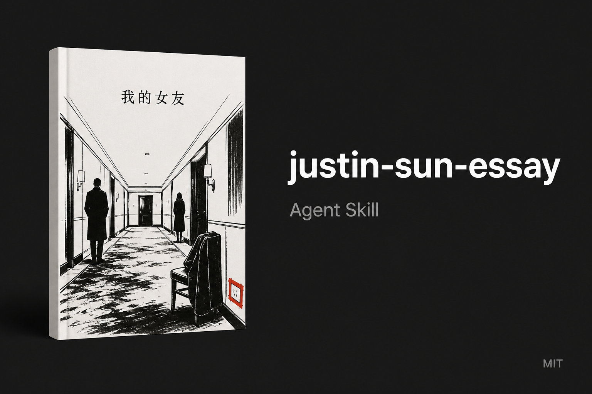

# justin-sun-essay

[](assets/card.png)

跨平台 [Agent Skill](https://agentskills.io/specification)。孙哥 / 孙宇晨公开长文的写法，不包含原文正文。

`name` 必须是 `justin-sun-essay`，目录名要一致。

## Install

把 `justin-sun-essay/` 整夹放进技能路径。

| Client | Path |
| --- | --- |
| 通用 / Codex | `.agents/skills/justin-sun-essay/` 或 `~/.agents/skills/justin-sun-essay/` |
| Claude Code | `~/.claude/skills/justin-sun-essay/` |
| Cursor | `.cursor/skills/justin-sun-essay/` |
| OpenCode | `.opencode/skills/justin-sun-essay/` 或 `~/.config/opencode/skills/justin-sun-essay/` |
| OpenClaw | `~/.openclaw/skills/justin-sun-essay/` |
| Hermes | `~/.hermes/skills/justin-sun-essay/` |

没有技能目录就新建。不要只拷 `SKILL.md` 改名。很多客户端同时认 `.agents/skills/`。

## Use

跟 agent 说：用孙哥那种写法写…… / Justin Sun essay voice。

只学短句、对话、数字、跳场。用户不给人和事，不要自己点真人的名。

## 示例（原创，不是原文）

输入：写我和一个女生在机场转机，她问下次能不能来上海，我没接。

输出：

转机是凌晨四点。

候机厅二十三度。

她问，下次你能来上海吗。

登机牌上写着洛杉矶。

她又问了一遍。

我说行李还在转盘上。

行李是两只箱子。

一只是她的。

## Publish / fork

可以 fork [HEJustinSun/my-girlfriend-jingtian-latex](https://github.com/HEJustinSun/my-girlfriend-jingtian-latex) 再叠这个技能。原仓库没有 license，fork 只为指向原文排版工程，不把正文改成你的。

建议仓库结构：

```
<your-fork>/
  README.md                 # 本说明 + 图
  justin-sun-essay/         # 本技能（目录名不要改）
    SKILL.md
  main.tex                  # 上游原文，保持不动
```

上游：https://github.com/HEJustinSun/my-girlfriend-jingtian-latex

## Not this

不是原文镜像。文风不受版权保护，正文受。本技能 MIT。不是官方授权。
